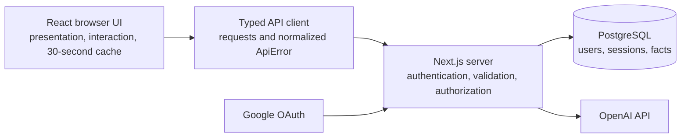
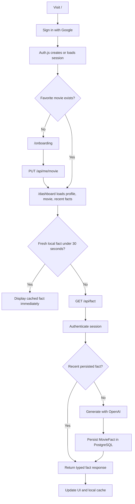
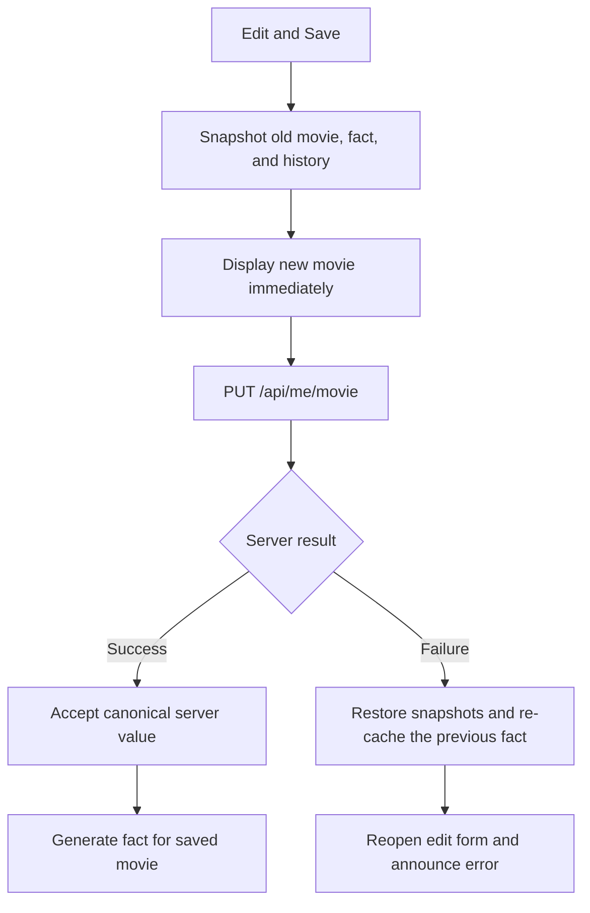

# Movie Memory

Movie Memory is a small full-stack application that lets a user sign in with Google, save a favorite movie, and generate a persistent AI-written fact about that movie.

The project deliberately favors correctness, explicit boundaries, and explainable decisions over feature volume. It uses the required stack: TypeScript, Next.js App Router, React, Tailwind CSS, PostgreSQL, Prisma, Google OAuth, and the OpenAI API.

## Chosen extension: Variant B

I chose **Variant B - Frontend/API-Focused (Client Orchestration)**.

Variant B fit the product because the most important interaction is not simply generating text; it is keeping the browser, API, database, and user-visible state consistent while the favorite movie is edited and facts are cached or refreshed. This variant demonstrates:

- explicit, shared API contracts;
- one normalized error model for every browser request;
- an optimistic edit with a complete rollback path;
- a 30-second per-user, per-movie client cache;
- deliberate loading, empty, refresh, and error states; and
- tests at the cache, client, component, and route-handler boundaries.

No external client-state library is used. The state graph is small enough that React state plus a focused cache module is easier to audit than adding SWR or React Query.

## Requirement coverage

| Requirement | Implementation |
| --- | --- |
| Google authentication | Auth.js Google provider with the Prisma adapter |
| First-time onboarding | Authenticated users without `favoriteMovie` are redirected to `/onboarding` |
| Returning-user flow | Authenticated users with a movie are redirected to `/dashboard` |
| Server-side validation | Zod trims the title and enforces a 1-120 character limit |
| Persistent user/movie data | PostgreSQL through Prisma |
| User profile | Google name, email, photo, and graceful fallbacks |
| OpenAI fact generation | Server-only OpenAI Responses API integration |
| Persistent facts | Each generated fact is stored as a `MovieFact` row |
| Typed API layer | Shared TypeScript contracts and a single `requestJson` client |
| Inline movie editing | Save, Cancel, optimistic display, and rollback on failure |
| Client cache | `localStorage`, 30-second TTL, explicit refresh bypass, movie-change invalidation |
| Security | Every protected application query derives ownership from the server session, never from request input |
| Tests | API errors, edit success/rollback, cache TTL/reuse, retry states, route auth, OpenAI failure, and request coalescing |

## How the application works

The system has four layers, each with one clear responsibility:



The complete user and data flow is:



The server owns identity, validation, persistence, and secrets. The browser owns presentation and temporary interaction state. The typed HTTP contract connects them without allowing the browser to access Prisma or OpenAI directly.

### Editing a movie

Movie editing is optimistic: the new title appears immediately while the request runs.



Restoring every dependent value matters. Restoring only the heading could leave an old movie displayed with a fact or cache entry belonging to the attempted new movie.

## Quick start

### Prerequisites

- Node.js 20.19+ (or another version supported by the installed dependencies)
- npm
- PostgreSQL
- a Google Cloud OAuth client
- an OpenAI API key

### 1. Install dependencies

For a clean, lockfile-reproducible install:

```bash
npm ci
```

### 2. Configure environment variables

Copy the committed template:

```bash
cp .env.example .env
```

Fill in these values:

| Variable | Purpose | Secret? |
| --- | --- | --- |
| `DATABASE_URL` | PostgreSQL connection string used by Prisma | Yes |
| `AUTH_SECRET` | Cryptographic secret used by Auth.js | Yes |
| `AUTH_GOOGLE_ID` | Public identifier for the Google OAuth client | No |
| `AUTH_GOOGLE_SECRET` | Google OAuth client secret | Yes |
| `OPENAI_API_KEY` | Authenticates server-side OpenAI requests | Yes |
| `OPENAI_MODEL` | Selects the text model without a code change | No |

Generate an Auth.js secret with:

```bash
openssl rand -base64 32
```

An example development model value is `gpt-4o`. Keeping the model in configuration makes cost or model changes a deployment decision rather than a source-code edit.

No secret uses a `NEXT_PUBLIC_` prefix. Next.js therefore does not bundle these values into client JavaScript.

### 3. Configure Google OAuth

In Google Cloud Console:

1. Create or select a project.
2. Configure the OAuth consent screen.
3. Create an **OAuth client ID** with application type **Web application**.
4. Add `http://localhost:3000` as an authorized JavaScript origin.
5. Add `http://localhost:3000/api/auth/callback/google` as an authorized redirect URI.
6. Put the generated client ID and secret into `.env`.

The app name shown on Google's consent page comes from the Google OAuth consent-screen branding, not from this repository.

### 4. Create and migrate the database

Create the PostgreSQL database referenced by `DATABASE_URL`, then generate the Prisma client and apply the committed migration:

```bash
npm run db:generate
npm run db:deploy
```

`db:deploy` is the reproducible setup path for reviewers because it applies committed migrations without creating a new one. During schema development, use:

```bash
npm run db:migrate -- --name describe_the_change
```

### 5. Start the application

```bash
npm run dev
```

Open [http://localhost:3000](http://localhost:3000).

## User journey

1. An unauthenticated visitor opens `/` and sees **Continue with Google**.
2. Auth.js completes Google's OAuth flow and stores the user, account, and session through the Prisma adapter.
3. The root server component checks whether that user has a favorite movie.
4. A first-time user is sent to `/onboarding`; a returning user is sent to `/dashboard`.
5. Onboarding sends the movie to `PUT /api/me/movie`.
6. The route authenticates the request, validates and trims the title, and updates only the signed-in user's row.
7. The dashboard reads the profile and the three newest facts for the current movie on the server.
8. The client checks the 30-second fact cache. A valid entry renders immediately; otherwise it requests `GET /api/fact`.
9. An explicit **Generate another** action calls `GET /api/fact?refresh=1`, which bypasses reuse and persists a new fact.
10. Editing the movie updates the title optimistically. Success commits the new state and generates a fact; failure restores the old movie, fact, history, and edit form, then writes the previous fact back to cache.

## Architecture overview

The application is a small monolith with explicit browser, HTTP, domain-integration, and persistence boundaries:

```text
Google OAuth
    |
    v
Auth.js + Prisma adapter ---------> PostgreSQL
    |
    | authenticated session
    v
Next.js Server Components
    |  initial profile/fact reads and redirects
    v
React Client Components
    |
    | typed calls through lib/api.ts
    v
Next.js Route Handlers
    |-- auth() establishes the user identity
    |-- Zod validates untrusted input
    |-- Prisma reads/writes user-owned rows
    `-- OpenAI generates a fact on the server only
```

### Why these boundaries

**Server Components by default.** Landing, onboarding, and dashboard pages make authentication decisions and initial database reads on the server. This avoids exposing database access and prevents a protected page from briefly rendering before a client-side redirect.

**Small Client Components for interaction.** Only the forms and dashboard interactions need browser state. This keeps the client bundle and state surface narrow.

**An HTTP boundary even though the code is co-located.** Variant B specifically evaluates API contracts. Its profile, movie, and fact operations therefore go through route handlers rather than importing database functions into client components. Authentication actions remain managed by Auth.js.

**Server-owned identity.** The API never accepts a `userId`. Every route calls `auth()` and scopes Prisma queries with `session.user.id`. The `userId` used in the browser cache is only a namespace for local data; it never authorizes a server operation.

**Shared transport types.** `lib/contracts.ts` defines request, success, and error shapes. Route handlers return those shapes, while `lib/api.ts` centralizes fetch behavior and converts non-success responses into `ApiError`.

See [docs/architecture.md](docs/architecture.md) for the detailed data model, endpoint contracts, state transitions, cache rules, and failure analysis.

## Data model

Auth.js owns the standard `User`, `Account`, `Session`, and `VerificationToken` models. The application adds `favoriteMovie` to `User` and a one-to-many `MovieFact` model.

```text
User 1 ---- * MovieFact
  |             |
  |             +-- movieTitle: snapshot at generation time
  |             +-- content: generated fact
  |             `-- createdAt: ordering/cache timestamp
  |
  +-- favoriteMovie: current preference
  +-- name/email/image: Google profile fields
```

`MovieFact.movieTitle` intentionally duplicates the title instead of relying only on `User.favoriteMovie`. It is a historical snapshot: changing the current favorite must not relabel old generated facts.

The index `@@index([userId, movieTitle, createdAt])` matches the main read pattern: find one user's newest facts for one movie. Cascading deletes remove Auth.js records and facts if the user is deleted.

## API contracts

### Error shape

Handled API failures use one predictable structure:

```json
{
  "error": {
    "code": "INVALID_MOVIE",
    "message": "Check the movie title and try again.",
    "issues": {
      "favoriteMovie": ["Enter a movie title."]
    }
  }
}
```

The `issues` object is optional. `lib/api.ts` maps this response to `ApiError`, preserving `status`, `code`, `message`, and field issues.

### `GET /api/me`

Returns the current authenticated user's profile.

```json
{
  "user": {
    "id": "user-id",
    "name": "Example User",
    "email": "user@example.com",
    "image": "https://...",
    "favoriteMovie": "Arrival"
  }
}
```

Relevant errors: `401 UNAUTHORIZED`, `404 USER_NOT_FOUND`.

### `PUT /api/me/movie`

Request:

```json
{ "favoriteMovie": "  Arrival  " }
```

The server trims the value, enforces 1-120 characters, and returns the updated profile. It does not accept an identity field.

Relevant errors: `400 INVALID_MOVIE`, `401 UNAUTHORIZED`.

### `GET /api/fact`

Returns a fact for the authenticated user's current movie. Normal requests may reuse a fact created within the 30-second window. `?refresh=1` explicitly generates and persists a new fact.

```json
{
  "fact": {
    "id": "fact-id",
    "movieTitle": "Arrival",
    "content": "A concise movie fact.",
    "createdAt": "2026-11-12T12:00:00.000Z"
  }
}
```

Relevant errors: `401 UNAUTHORIZED`, `409 MOVIE_REQUIRED`, `502 FACT_GENERATION_FAILED`.

## Client state and cache strategy

### Cache key and value

The browser stores one entry under a normalized key:

```text
movie-memory:fact:<userId>:<trimmed-lowercase-movie-title>
```

The value contains the typed fact and the time it entered the cache:

```ts
type FactCacheEntry = {
  fact: MovieFactDto;
  cachedAt: number;
};
```

### Cache rules

1. On dashboard load, read the key for the current user and movie.
2. If `now - cachedAt < 30_000`, display it without an API request.
3. At exactly 30 seconds, remove it and fetch a fact.
4. **Generate another** clears the entry and sends `refresh=1`.
5. A movie change clears both the old-movie and proposed-new-movie entries.
6. If the movie save fails, restore the previous fact to state and write it back to local storage with a new cache timestamp.
7. Simultaneous initial loads for the same key share one in-flight promise.

The server also checks for a recently persisted fact and coalesces simultaneous normal requests within one Node.js process. This is defense-in-depth for React development replay or multiple tabs reaching the server before local storage is updated. It is not presented as a distributed lock; that limitation is documented below.

### Optimistic edit state transition

```text
Viewing old movie
    |
    | Edit -> Save
    v
Optimistically show new movie
clear active fact/history/cache
disable duplicate save
    |
    +-- PUT succeeds --> accept canonical title --> generate new fact
    |
    `-- PUT fails ----> restore old title, fact, and history
                        re-cache the previous fact
                        reopen edit form and announce the error
```

The rollback is intentionally complete. Restoring only the heading would leave the page internally inconsistent and could cause a later cache read to disagree with the visible UI.

## Loading, empty, and failure behavior

- Initial generation shows a labelled skeleton rather than an empty card.
- Refresh keeps the previous fact visible at reduced emphasis while the request runs.
- Buttons are disabled during incompatible operations to prevent duplicate submissions.
- A failed initial fact request shows the cause and a **Try again** action.
- A failed refresh preserves the previous fact and writes it back with a new cache timestamp.
- A failed movie save places the error beside the edit form and restores the complete previous state.
- Missing Google photos use initials; missing names fall back to the email local part or `Movie fan`.
- Dynamic states use semantic status/alert roles, visible keyboard focus, and reduced-motion support.

## Security and correctness

### Authentication and authorization

- Protected pages call `auth()` before reading data and redirect unauthenticated users to `/`.
- Every API route rejects an absent session before touching the database.
- The session callback adds the database user ID to the server-verified session.
- Route handlers always derive ownership from `session.user.id`.
- Fact queries include both `userId` and `movieTitle`; a caller cannot select another user's facts.

### Input and output safety

- Zod performs server-side trimming and length validation before a write.
- React escapes rendered movie titles and fact text by default.
- The OpenAI key and database credentials are imported only by server-only modules.
- OpenAI is instructed to return concise plain text, and empty responses are rejected.
- Fact-generation failures are logged server-side and returned as a stable, user-friendly error. If an unexpected endpoint failure returns non-JSON, the client still converts it to `ApiError` with `UNKNOWN_ERROR`.

## Tests

The suite is intentionally boundary-oriented:

| Test file | What it proves |
| --- | --- |
| `lib/api.test.ts` | 401/500 normalization and explicit refresh URL |
| `lib/fact-cache.test.ts` | simultaneous-load coalescing and exact 30-second expiration |
| `components/dashboard-client.test.tsx` | optimistic success, complete rollback, cache reuse, and recoverable errors |
| `tests/route-handlers.test.ts` | unauthenticated rejection, validation, OpenAI failure, server coalescing, and refresh bypass |

Run the tests:

```bash
npm test
```

Run the full submission check:

```bash
npm run verify
```

`verify` runs ESLint, all Vitest tests, TypeScript checking through the Next.js production build, and the complete production build.

## Project structure

```text
app/
  api/                    authenticated route handlers
  dashboard/              protected returning-user page
  onboarding/             protected first-time-user page
components/
  dashboard-client.tsx    Variant B state orchestration
  onboarding-form.tsx     first movie mutation
lib/
  api.ts                  typed browser client and ApiError
  cache-policy.ts         shared 30-second TTL
  contracts.ts            shared transport types
  fact-cache.ts           localStorage cache and request coalescing
  http.ts                 normalized API error responses
  openai.ts               server-only OpenAI integration
  prisma.ts               server-only Prisma singleton
  validation.ts           Zod input schema
prisma/
  migrations/             reproducible SQL history
  schema.prisma           relational data model
tests/                    route-handler tests and test setup
docs/
  architecture.md         detailed design rationale
```

## Key tradeoffs

### React state instead of a data-fetching library

There is one editable record and one cached resource. A small reducer-like set of state variables plus a dedicated cache module keeps behavior visible and avoids adding a dependency whose invalidation model would still need to be explained. If the dashboard grew to multiple server resources, pagination, or background synchronization, React Query would become worthwhile.

### `localStorage` instead of an in-memory-only cache

It survives navigation and reloads during the 30-second window. It contains no credentials or access tokens, and the key includes the user and movie to avoid cross-account or cross-movie reuse in the same browser. It is not treated as authoritative; the server still authenticates every request.

### Process-local request coalescing

The client map prevents duplicate work inside one browser JavaScript context; it does not coordinate separate tabs. The server map coalesces tabs only when their requests reach the same running server process, and it does not coordinate multiple server instances. The persisted recent-fact check covers many later requests, but a production-scale version would still use a database uniqueness strategy, advisory lock, or Redis-based distributed lock.

### Compile-time response types

The shared contracts provide strong TypeScript ergonomics, but successful API responses are not runtime-parsed in the browser. For a larger or separately deployed API, I would define Zod response schemas and infer the TypeScript types from them to prevent contract drift at runtime.

### AI fact quality

Prompting reduces uncertain output but does not guarantee factual accuracy. A production product would ground facts in a trusted movie source, store citations, moderate output, and expose provenance.

## What I would improve with two more hours

1. Add Playwright end-to-end coverage for login redirects, onboarding, edit success, edit rollback, and refresh behavior using mocked OAuth/OpenAI boundaries.
2. Add a database-backed or Redis-backed idempotency mechanism so request coalescing works across multiple application instances.
3. Add Zod schemas for successful API responses and infer the client types from those schemas.
4. Add request timeouts, structured logging, and basic rate limiting around fact generation.
5. Add trusted-source grounding and citations for generated movie facts.

## AI usage

AI tools were used to:

- turn the take-home specification into an implementation checklist;
- compare architecture options and identify edge cases in optimistic updates and cache invalidation;
- assist with code scaffolding, test cases, and UI-state copy;
- review the implementation for security, accessibility, and failure behavior; and
- improve documentation clarity.

All generated or suggested code was reviewed, adapted to this repository, and verified with the test, lint, type-check, build, and live application workflows. The architecture document records the submitted components and decisions so they can be reviewed directly from the repository.

## Useful commands

```bash
npm run dev          # start the development server
npm run lint         # run ESLint
npm test             # run all tests once
npm run test:watch   # run tests in watch mode
npm run build        # create a production build and run Next.js type checks
npm run verify       # lint + test + production build
npm run db:generate  # regenerate the Prisma client
npm run db:migrate   # create/apply a development migration
npm run db:deploy    # apply committed migrations
```
